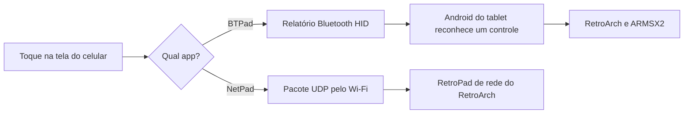

# Tablet Android para jogos retrô

Guia e ferramentas para deixar um tablet Android antigo mais leve e transformá-lo em um console de emulação, sem root. O projeto explica por que esses aparelhos ficam lentos, mostra como remover o excesso de software por ADB e configura emuladores de PS1, PS2 e outros consoles. Também traz dois apps que transformam o celular em controle.

Foi desenvolvido e testado em um **Samsung Galaxy Tab A8 (SM-X200)** com Android 14, One UI 6, chip Unisoc T618 e 3,4 GB de RAM. Em outros modelos, use os [prompts com varredura](#usar-com-um-agente-de-ia) e adapte o que for diferente.

## Conteúdo

- [Resultados medidos](#resultados-medidos)
- [Por que os tablets ficam lentos](#por-que-os-tablets-ficam-lentos)
- [O que é obsolescência programada](#o-que-é-obsolescência-programada)
- [Como o projeto funciona](#como-o-projeto-funciona)
- [O que há no repositório](#o-que-há-no-repositório)
- [Requisitos](#requisitos)
- [Otimizar o tablet](#otimizar-o-tablet)
- [Medir o seu ganho](#medir-o-seu-ganho)
- [Instalar os emuladores](#instalar-os-emuladores)
- [Usar o celular como controle](#usar-o-celular-como-controle)
- [Compilar os apps](#compilar-os-apps)
- [Usar com um agente de IA](#usar-com-um-agente-de-ia)
- [Problemas comuns](#problemas-comuns)
- [Direitos autorais](#direitos-autorais)
- [Fontes](#fontes)
- [Licença](#licença)

## Resultados medidos

O ganho varia conforme o aparelho e quanto software de fábrica ele tem. Estes foram os números medidos no Tab A8:

| Medida | Antes | Depois |
| --- | --- | --- |
| Apps ativos | 333 | 267 |
| RAM livre | cerca de 1,4 GB | cerca de 1,9 GB logo após o processo |
| Animações da interface | ligadas | desligadas |
| Limitadores de jogos da Samsung | ativos | removidos |

Não houve medição de velocidade geral, como um benchmark antes e depois, então este projeto não promete um percentual fixo de ganho. Para saber quanto o seu tablet melhorou, siga [Medir o seu ganho](#medir-o-seu-ganho).

Situação de cada parte:

| Parte | Situação | Evidência |
| --- | --- | --- |
| Otimização do tablet | Funciona | Medidas da tabela acima |
| RetroArch (PS1 e outros) | Funciona | Resident Evil 3 abriu no PCSX-ReARMed; os demais núcleos foram instalados, mas nem todos testados com jogo |
| PS2 (ARMSX2) | Funciona no jogo testado | GTA III a cerca de 30 FPS e 100% de velocidade em um teste de cerca de 8 minutos |
| BTPad (controle Bluetooth) | Funciona | O tablet recebeu botões, setas e analógico de um POCO X5 Pro 5G |
| Tela de configuração do BTPad | Testada só no tablet | Falta confirmar no celular |
| Dois celulares ao mesmo tempo | Não testado | |
| NetPad (controle por Wi-Fi) | Funciona, com atraso | Ficou lento no POCO X5 Pro; causa não confirmada |
| Controle 2.4 GHz por OTG | Não testado | Faltou o adaptador |

## Por que os tablets ficam lentos

Um tablet raramente fica lento por um único motivo. O hardware continua o mesmo, enquanto o software fica mais exigente e o aparelho acumula desgaste.

| Causa | O que acontece | O projeto resolve? |
| --- | --- | --- |
| Apps de fábrica e em segundo plano | Serviços que você não usa ocupam RAM e processador, e o Android precisa fechar outros apps com mais frequência | Sim: remove os que você não usa |
| Apps e sistema mais pesados | Cada atualização é pensada para aparelhos mais novos, e o hardware antigo não acompanha | Em parte: reduz o que roda junto |
| Armazenamento cheio e fragmentado | Ler e gravar pode demorar mais, o que atrasa a abertura de apps | Em parte: limpa caches e libera espaço |
| Compilação sob demanda | Parte do código dos apps é interpretada ou compilada enquanto roda | Sim: pré-compila os apps |
| Bateria envelhecida | A bateria perde capacidade, e alguns aparelhos reduzem o desempenho para evitar desligamentos | Não: exige trocar a bateria |
| Calor | O chip reduz a velocidade para não superaquecer | Não: o resfriamento continua igual |
| Limite do hardware | O processador, a memória e os gráficos são os mesmos de fábrica | Não: nenhum software muda isso |

O desgaste físico da memória costuma pesar menos do que parece. Um [estudo da Universidade da Carolina do Norte](https://www.cs.unc.edu/~porter/pubs/fbrick-mobisys-2019.pdf) concluiu que apps comuns raramente esgotam a memória flash de um celular. Já a [fragmentação do armazenamento](https://www.tuxera.com/blog/why-is-my-android-phone-slowing-down/) é apontada como um fator importante no envelhecimento desses aparelhos.

## O que é obsolescência programada

**Obsolescência programada**, às vezes chamada de "defeito programado", é a prática de projetar um produto para durar menos ou ficar ultrapassado mais cedo, de modo que o consumidor compre outro. Ela não precisa ser um defeito físico. Também pode aparecer em atualizações que pesam demais, em peças difíceis de trocar e no fim do suporte de software.

Provar a intenção é difícil, mas já houve casos com consequências reais:

- **Itália, 2018:** o órgão regulador [multou a Apple em 10 milhões de euros e a Samsung em 5 milhões](https://mobilesyrup.com/2018/10/24/apple-samsung-fined-italy-slowing-down-phones/). Segundo a decisão, atualizações reduziram o desempenho de celulares e aceleraram sua troca. No caso da Samsung, o alvo foi uma atualização para o Galaxy Note 4. A Samsung disse que recorreria.
- **Estados Unidos, 2020:** a Apple [aceitou pagar até 500 milhões de dólares](https://www.fox29.com/news/apple-could-pay-up-to-500m-over-battery-related-phone-slowdown) para encerrar processos sobre a lentidão de iPhones antigos. A empresa não admitiu irregularidade. Ela já havia reconhecido que limitava o desempenho de aparelhos com bateria desgastada, para evitar desligamentos.

**O que isso significa para o seu tablet:** esses casos mostram que atualizações podem deixar aparelhos antigos mais lentos, e que nem sempre o consumidor é avisado. Mas eles não provam que o seu modelo foi feito para ficar lento, e este projeto não encontrou evidência disso no Tab A8. Na prática, a lentidão costuma vir da soma das causas da seção anterior, com ou sem intenção do fabricante.

O importante é que boa parte do problema é software, e software pode ser removido. Por isso, um aparelho que parece ultrapassado às vezes ainda tem muitos anos de uso pela frente.

## Como o projeto funciona

O projeto tem três partes, que podem ser usadas separadamente.

### 1. Otimização por ADB

O ADB é a ferramenta oficial do Android para controlar um aparelho pelo computador. Com ele, cada mudança é feita sem root e sem desbloquear o sistema.

- **Remoção de apps:** `pm uninstall --user 0` retira o app do usuário atual, mas mantém a cópia original no sistema. Sem o app ativo, seus serviços não rodam e a RAM fica livre. Como a cópia continua lá, é possível reinstalar. Por outro lado, esse comando quase não libera espaço interno, e uma atualização do sistema pode trazer o app de volta.
- **Animações:** cada abertura de tela deixa de esperar a animação terminar. O processador não fica mais rápido, mas a interface responde antes.
- **Pré-compilação:** normalmente, o Android [compila aos poucos só as partes mais usadas](https://source.android.com/docs/core/runtime/configure) de cada app. O modo `speed` compila tudo com antecedência, o que dá um desempenho mais constante, mas ocupa mais espaço.
- **Limitadores de jogos:** no Samsung, o Game Optimizing Service e o Smart FPS Adjuster podem controlar o desempenho dos jogos. Removê-los libera o aparelho, mas ele pode esquentar mais.

### 2. Emulação

Um emulador imita o console em software, e por isso exige bem mais do que o jogo original.

- **RetroArch:** é uma interface única para vários emuladores, chamados de núcleos. Cada console tem o seu, e todos usam os mesmos menus e controles.
- **ARMSX2:** é um emulador dedicado ao PS2, derivado do PCSX2. É bem mais pesado, então o resultado depende muito do chip e do jogo.

### 3. Celular como controle



- **BTPad:** o celular se apresenta como um controle Bluetooth comum, e o tablet o trata como um controle físico. Não depende do Wi-Fi.
- **NetPad:** o app envia cada comando pela rede para o RetroArch. É mais simples, mas sofre com a rede e a economia de energia do celular, e só funciona com o RetroArch.

## O que há no repositório

| Caminho | Conteúdo |
| --- | --- |
| `gamepad-bt/` | Código do BTPad, controle por Bluetooth (recomendado) |
| `gamepad-app/` | Código do NetPad, controle por Wi-Fi |
| `BTPad.apk`, `NetPad.apk` | Apps compilados, assinados com chave de desenvolvimento |
| `removidos.txt` | Os 68 pacotes removidos do Tab A8 |
| `armar-wifi-com-usb.bat` | Ativa o ADB sem fio, com o cabo ligado |
| `conectar-tablet-wifi.bat` | Reconecta o ADB sem cabo |
| `Tutoriais/Passo-a-passo-Galaxy-Tab-A8.md` | Passo a passo completo da otimização, dos emuladores e dos controles |
| `Tutoriais/Emulador-PS2-ARMSX2.md` | Guia completo do emulador de PS2 |
| `Tutoriais/App-de-controle.md` | Para que serve o app, como se comunica com o tablet e o que configurar |
| `Prompt-1-otimizar-tablet.txt` | Prompt para um agente otimizar qualquer tablet |
| `Prompt-2-emulador.txt` | Prompt para um agente instalar RetroArch, jogos e controles |
| `Prompt-3-emulador-ps2.txt` | Prompt para um agente instalar o emulador de PS2 |

Os guias também têm versão em PDF na pasta `Tutoriais`. Os dois scripts `.bat` usam o IP `192.0.2.1`, então troque pelo IP do seu tablet na linha `set IP=`.

## Requisitos

- Tablet Android com Depuração USB ligada.
- Computador com [ADB](https://dl.google.com/android/repository/platform-tools-latest-windows.zip). Os scripts do projeto são para Windows.
- Cabo USB de dados.
- Para o BTPad: celular com Android 9 ou superior.
- Para o PS2: tablet de 64 bits. O [ARMSX2 recomenda](https://armsx2.net/docs/system-requirements) 6 GB de RAM e um chip de alto desempenho.
- Seus próprios jogos e, quando o emulador exigir, a BIOS do seu próprio console.

## Otimizar o tablet

As mudanças não exigem root e podem ser revertidas. Leia a lista antes de remover qualquer coisa: ela foi feita para um Tab A8 sem chip e sem conta Google, e pode não servir para o seu caso.

```bash
# Guarde a lista atual de apps
adb shell pm list packages -e > antes.txt

# Remova um app apenas do usuário atual
adb shell pm uninstall --user 0 NOME.DO.PACOTE

# Desligue as animações
adb shell settings put global window_animation_scale 0
adb shell settings put global transition_animation_scale 0
adb shell settings put global animator_duration_scale 0

# Limpe os caches e pré-compile os apps (pode levar vários minutos)
adb shell pm trim-caches 999G
adb shell cmd package compile -m speed -f -a

adb reboot
```

**Para reverter:**

```bash
adb shell cmd package install-existing NOME.DO.PACOTE
adb shell settings put global window_animation_scale 1
adb shell settings put global transition_animation_scale 1
adb shell settings put global animator_duration_scale 1
```

Não remova a loja de apps, o único navegador, o único teclado nem o Google Play Services. Se `adb devices` vier vazio em um Samsung, ligue a **Ancoragem USB**: foi o que fez o ADB aparecer no Tab A8.

## Medir o seu ganho

Meça **antes** de mudar qualquer coisa, repita depois de reiniciar e compare. Faça cada medida três vezes, com o tablet parado há dois minutos.

```bash
# RAM livre
adb shell grep MemAvailable /proc/meminfo

# Apps ativos (conte as linhas do resultado)
adb shell pm list packages -e

# Tempo de abertura de um app, em milissegundos (veja TotalTime)
adb shell am force-stop com.android.settings
adb shell am start -W -n com.android.settings/.Settings
```

Use o mesmo app nas duas medições e calcule assim: `ganho (%) = (tempo antes - tempo depois) / tempo depois x 100`. Por exemplo, se a abertura caiu de 1.000 ms para 800 ms, o app abre 25% mais rápido. Um benchmark instalado antes e depois também ajuda, desde que seja o mesmo app e a mesma versão.

Se você medir, compartilhe o resultado com o modelo do aparelho. Assim, o projeto passa a ter números reais de mais tablets.

## Instalar os emuladores

### RetroArch

1. Baixe a versão para o seu processador em [buildbot.libretro.com/stable](https://buildbot.libretro.com/stable/). No Tab A8, foi usado o `RetroArch_aarch64.apk` da versão 1.22.2.
2. Instale o APK e aceite o acesso aos arquivos.
3. Em **Atualizador Online > Baixar Núcleo**, baixe os núcleos da tabela abaixo.
4. Em **Configurações > Entrada > Teclas de atalho**, ajuste o menu para **Manter pressionado Start (2 segundos)**.
5. Só depois, no Menu Rápido de um jogo, desligue **Overlay na tela > Exibir Overlay**. Na ordem inversa, o menu fica inacessível.
6. Grave em **Menu principal > Arquivo de Configuração > Salvar configuração atual**. Fechar o app à força não salva nada.

| Console | Núcleo | Pasta |
| --- | --- | --- |
| PlayStation 1 | PCSX-ReARMed | `/sdcard/ROMs/psx` |
| PSP | PPSSPP | `/sdcard/ROMs/psp` |
| Nintendo 64 | Mupen64Plus-Next GLES2 | `/sdcard/ROMs/n64` |
| Super Nintendo | Snes9x | `/sdcard/ROMs/snes` |
| NES | FCEUmm | `/sdcard/ROMs/nes` |
| Game Boy e Color | Gambatte | `/sdcard/ROMs/gb`, `/sdcard/ROMs/gbc` |
| Game Boy Advance | mGBA | `/sdcard/ROMs/gba` |
| Mega Drive, Master System e Game Gear | Genesis Plus GX | `/sdcard/ROMs/megadrive`, `/sdcard/ROMs/mastersystem`, `/sdcard/ROMs/gamegear` |

Jogos de PS1 precisam da imagem e de um `.cue`. Se o tamanho da imagem for divisível por 2352 e não houver `.cue`, crie um com o mesmo nome:

```text
FILE "Nome do jogo.bin" BINARY
  TRACK 01 MODE2/2352
    INDEX 01 00:00:00
```

### ARMSX2 (PS2)

O guia completo está em [`Tutoriais/Emulador-PS2-ARMSX2.md`](Tutoriais/Emulador-PS2-ARMSX2.md). O resumo é:

1. Baixe a versão adequada em [ARMSX2/ARMSX2](https://github.com/ARMSX2/ARMSX2/releases). No Tab A8, com Android 14, foi usado o `ARMSX2-2.9.1-a13-armv8.2-sdk33.apk`.
2. Coloque seus arquivos no tablet, por exemplo em `/sdcard/ROMs/_BIOS/ps2` e `/sdcard/ROMs/ps2`.
3. Abra o app e indique as duas pastas na configuração inicial.
4. Ligue o **Ajuste automático de desempenho**, útil em tablets mais fracos.

Resultado no Tab A8, com o GTA III em resolução nativa:

| Momento | FPS | Velocidade | Uso da CPU emulada |
| --- | --- | --- | --- |
| Parado na rua | 29,98 | 100% | 66% |
| Dirigindo | 29,64 | 102% | 77% |
| Dirigindo em Chinatown | 29,95 | não registrada | 85% |

Com a CPU emulada em 85%, sobra pouca folga, então cenas mais cheias podem ter quedas. O teste durou cerca de 8 minutos e vale só para esse jogo. Outros jogos podem rodar pior.

A BIOS não faz parte deste projeto. O ARMSX2 pede uma cópia extraída de um PS2 seu.

## Usar o celular como controle

O app transforma o celular em controle para jogar no tablet. Há duas versões, e os dois APKs são instalados só no **celular**. A explicação completa, com o funcionamento e a configuração, está em [`Tutoriais/App-de-controle.md`](Tutoriais/App-de-controle.md).

| | BTPad (recomendado) | NetPad |
| --- | --- | --- |
| Conexão | Bluetooth | Wi-Fi |
| Funciona com | Android do tablet, inclusive o RetroArch | Só o RetroArch |
| Configuração | Parear uma vez | IP do tablet, jogador e RetroPad de rede |

### BTPad (Bluetooth)

**Primeira vez:**

1. Copie o `BTPad.apk` para o **celular**, instale e abra. O celular precisa de Android 9 ou superior.
2. Permita o Bluetooth, que em muitos aparelhos aparece como Dispositivos próximos.
3. Toque em **Config > Tornar visível pra parear**. O celular fica visível por 5 minutos.
4. No tablet, abra **Configurações > Conexões > Bluetooth**, procure e toque no nome do celular.
5. Confirme o código nos dois aparelhos.
6. O app conecta sozinho. Se não conectar, toque em **CONECTAR**.
7. Confira se o status mostra **CONECTADO** em verde.

**Nas próximas vezes:** abra o app e espere conectar. Não é preciso parear de novo.

**Durante o jogo:** mantenha o BTPad aberto na tela do celular. Em segundo plano, o Android desliga o modo controle.

**Dois jogadores:** repita os passos no segundo celular. Esse caso ainda não foi testado.

> **Nunca dê permissão de Bluetooth ao BTPad no tablet.** Ele passaria a agir como controle, desligaria a recepção de controles do tablet e se conectaria ao celular ao contrário.

O menu **Config** oferece:

| Opção | O que faz |
| --- | --- |
| Direcional | Mostra setas, analógico ou os dois. O analógico também aciona as setas |
| Setas | 4 direções evita apertar duas setas sem querer; 8 direções permite diagonais |
| Trava de L1 L2 R1 R2 | Define como os botões de cima travam |
| Trava de ✕ ○ □ △ | Define como os botões de ação travam |
| Tempo pra travar | 1, 2 ou 3 segundos, no modo Segurar |
| Mostrar diagnóstico | Exibe o contador de envios e o log da conexão |
| Mudar posições | Permite arrastar cada controle. Use Salvar, Padrão ou Sair |
| Tornar visível pra parear | Deixa o celular visível para um novo pareamento |

Os modos de trava são: **Sem trava**, que age como um botão normal; **Segurar**, que trava depois do tempo escolhido e solta com dois toques; e **Liga/desliga**, que alterna a cada toque.

O BTPad foi validado com o sistema do tablet, mas ainda não dentro do ARMSX2.

<details>
<summary>Detalhes técnicos do BTPad</summary>

- API: `BluetoothHidDevice`, Android 9 ou superior.
- Relatório HID: ID 1, com 5 bytes (`botões baixo`, `botões alto`, `hat`, `X`, `Y`).
- Botões: ✕=0, ○=1, □=3, △=4, L1=6, R1=7, L2=8, R2=9, Select=10, Start=11.
- Hat: 0 a 7 no sentido horário a partir de cima; `0x0F` é neutro.
- Eixos X e Y: de -127 a 127.
- Pacote: `com.cavaleiro.btpad`.

</details>

### NetPad (Wi-Fi)

Use se o seu celular não aceitar o modo controle Bluetooth. Só funciona com o RetroArch, e pode ter atraso.

1. Conecte o tablet e o celular à mesma rede Wi-Fi e anote o IP do tablet, nos detalhes da rede.
2. No RetroArch, abra **Configurações > Rede** e ligue o **RetroPad de rede** e os usuários 1 e 2.
3. Feche e abra o RetroArch para as portas entrarem no ar.
4. Instale o `NetPad.apk` no celular e abra.
5. Na engrenagem, informe o IP do tablet e o jogador. Mantenha a porta base em 55400.
6. Abra o jogo no RetroArch e mantenha o NetPad aberto no celular.

O jogador 1 usa a porta 55400 e o jogador 2, a 55401. O IP de fábrica do app é `192.0.2.1`, o do tablet de testes, então confira o seu.

## Compilar os apps

O projeto não usa Gradle. Os scripts chamam as ferramentas do Android diretamente e só rodam no Windows, com PowerShell.

1. Baixe e extraia em `gamepad-app/tools/`:

   | Ferramenta | Download | Pasta |
   | --- | --- | --- |
   | JDK 17 | [Temurin](https://api.adoptium.net/v3/binary/latest/17/ga/windows/x64/jdk/hotspot/normal/eclipse?project=jdk) | `jdk-x` |
   | Build-tools 34 | [build-tools_r34-windows.zip](https://dl.google.com/android/repository/build-tools_r34-windows.zip) | `bt-x` |
   | Android 34 | [platform-34-ext7_r03.zip](https://dl.google.com/android/repository/platform-34-ext7_r03.zip) | `plat-x` |

2. Ajuste os caminhos no início do `build.ps1`, que hoje apontam para `C:\Users\USUARIO\Desktop\tablet`.
3. Compile:

   ```powershell
   powershell -File gamepad-bt\build.ps1
   ```

O APK sai em `gamepad-bt/build/BTPad.apk`.

**Antes de compilar o NetPad:** o `gamepad-app/build.ps1` está desatualizado. Acrescente `-encoding UTF-8` à linha do `javac`, senão os acentos quebram. Ele também guarda a chave dentro de `build/`, que é apagada a cada compilação, então cada APK novo exige desinstalar o anterior.

## Usar com um agente de IA

Os prompts são independentes, e cada um começa com uma varredura do aparelho para decidir o que fazer naquele modelo. Preencha a parte `DADOS` e cole em um agente com acesso ao terminal do computador ligado ao tablet.

- [`Prompt-1-otimizar-tablet.txt`](Prompt-1-otimizar-tablet.txt): otimização, com aprovação antes de remover qualquer app.
- [`Prompt-2-emulador.txt`](Prompt-2-emulador.txt): RetroArch, jogos, controles e recriação do BTPad.
- [`Prompt-3-emulador-ps2.txt`](Prompt-3-emulador-ps2.txt): ARMSX2, com teste de desempenho por jogo.

O processo só foi executado de ponta a ponta no Tab A8. A varredura ainda não foi rodada como um bloco único.

## Problemas comuns

| Problema | Solução |
| --- | --- |
| `adb devices` vazio | Troque o cabo, use o modo Transferência de arquivos ou ligue a Ancoragem USB |
| `INSTALL_FAILED_VERIFICATION_FAILURE` | Copie o APK para o tablet e instale pelo gerenciador de arquivos. Não desative o verificador |
| `more than one device` | Use `adb -s SERIAL` |
| Um app removido fez falta | Rode `adb shell cmd package install-existing NOME.DO.PACOTE` |
| Apps removidos voltaram | Uma atualização do sistema pode reinstalá-los. Remova de novo |
| Menu inacessível no jogo | Ative o atalho de Start antes de esconder o overlay |
| Overlay ou atalho voltam ao reabrir | Salve a configuração atual ou saia pelo menu do RetroArch |
| Tablet diz "não foi possível conectar" | Abra o BTPad no celular e toque em CONECTAR |
| Tablet virou controle do celular | Desinstale o BTPad do tablet |
| Controle cai durante o jogo | Mantenha o BTPad aberto na tela do celular |
| Atualização do BTPad recusada | Desinstale a versão assinada com outra chave e instale de novo |
| Jogo de PS2 lento | Veja o guia do ARMSX2, confirme o ajuste automático e teste um jogo mais leve |

Mais detalhes em [`Tutoriais/Passo-a-passo-Galaxy-Tab-A8.md`](Tutoriais/Passo-a-passo-Galaxy-Tab-A8.md).

## Direitos autorais

Este repositório não inclui e não deve receber jogos comerciais nem BIOS de consoles, que são protegidos por direitos autorais. Use apenas arquivos que você tenha o direito de usar. Os nomes de consoles, jogos e fabricantes pertencem aos seus donos, e este projeto não tem ligação com eles.

## Fontes

- [Multas da Itália à Apple e à Samsung, 2018](https://mobilesyrup.com/2018/10/24/apple-samsung-fined-italy-slowing-down-phones/)
- [Acordo da Apple de até 500 milhões de dólares, 2020](https://www.fox29.com/news/apple-could-pay-up-to-500m-over-battery-related-phone-slowdown)
- [Compilação de apps no Android (ART)](https://source.android.com/docs/core/runtime/configure)
- [Estudo sobre desgaste da memória flash em celulares](https://www.cs.unc.edu/~porter/pubs/fbrick-mobisys-2019.pdf)
- [Fragmentação do armazenamento no Android](https://www.tuxera.com/blog/why-is-my-android-phone-slowing-down/)
- [Requisitos do ARMSX2](https://armsx2.net/docs/system-requirements)

## Licença

Ainda não há uma licença definida. Até que o autor escolha uma, os direitos sobre o código ficam reservados. O RetroArch e o ARMSX2 são projetos independentes, com licenças próprias.
